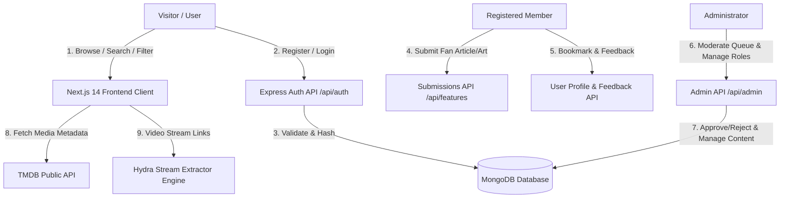
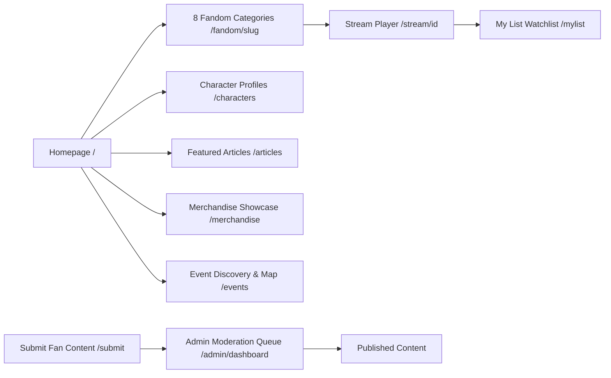

# Fan Hub Plus — Final Project Report & SRS Compliance Document

**Theme**: Fandom Universe  
**Category**: End-to-End Web Solutions  
**Project Name**: Fan Hub Plus  
**Event**: TechWiz 7 International Championship  

---

## 1. Problem Definition

Fandom communities exist across diverse entertainment domains — Anime, Gaming, Movies, TV Shows, K-Pop, Comics, Manga, and Cosplay. Currently, fans face several problems:
- **Fragmented Experience**: Fans must navigate scattered forums, social media, and niche websites.
- **Single-Fandom Limitation**: Existing sites rarely unify multiple fandoms under one roof.
- **Cluttered & Unsafe Sites**: Piracy-heavy or cluttered sites lack rich multimedia and high-quality browsing.
- **Lack of Local Community Discovery**: Fans cannot easily find nearby conventions, cosplay meetups, or release events.

**Fan Hub Plus** solves this by providing a unified, visually rich, and category-focused web portal backed by modern MERN + Next.js technologies.

---

## 2. Design Specifications & Tech Stack

### Frontend (Client)
- **Framework**: Next.js 14 App Router (React 18, Server Components + Client Side Rendering)
- **Styling**: Tailwind CSS + Custom Midnight Cyberpunk Palette + Dark Mode
- **Icons**: Lucide React
- **Deployment**: Localhost / Vercel ready

### Backend (Server)
- **Runtime**: Node.js & Express.js REST API
- **Database**: MongoDB & Mongoose ORM
- **Authentication**: Custom JWT (Access Tokens) + bcryptjs password hashing
- **Services**: TMDB API integration, Stream link aggregators, Torrent extractor pipeline

---

## 3. Mandatory User Credentials & Testing Accounts

> [!IMPORTANT]
> Use these credentials to test all user roles (Visitor, Registered User, Administrator).

| Role | Email | Password | Permissions & Features |
|---|---|---|---|
| **Administrator** | `admin@fanhub.com` | `admin123` | Access to `/admin/dashboard`, Content CRUD, Moderation Queue (Approve/Reject fan submissions), User Role Toggling, Analytics |
| **Registered User** | `user@fanhub.com` | `user123` | Full access, My List bookmarks, Profile editing, Favorite fandoms, Fan content submission (`/submit`), Ratings & Feedback |
| **Visitor** | *(Unauthenticated)* | N/A | Public browsing, 8 Fandom category hubs, Search, Event discovery, Merchandise showcase |

---

## 4. System Architecture & Flow Diagrams (DFD & Flowchart)

### 4.1 System Data Flow Diagram (DFD Level 1)



### 4.2 User Navigation Flowchart



---

## 5. Database Schema Design (MongoDB / Mongoose)

### 5.1 User Entity
- `_id`: ObjectId (PK)
- `name`: String (required)
- `email`: String (unique, required)
- `password`: String (bcrypt hash)
- `role`: Enum (`'user'`, `'admin'`)
- `avatar`: String (URL)
- `favorite_fandoms`: Array of Strings
- `bookmarks`: Array of ObjectId refs (`Content`)
- `reset_password_token`: String
- `reset_password_expires`: Date

### 5.2 Content Entity
- `_id`: ObjectId (PK)
- `title`: String
- `category`: Enum (`'Anime'`, `'Gaming'`, `'Movies'`, `'TV Shows'`, `'K-Pop'`, `'Comics'`, `'Manga'`, `'Cosplay'`)
- `type`: Enum (`'video'`, `'article'`, `'audio'`, `'image'`)
- `genre`: String
- `release_year`: Number
- `popularity_score`: Number
- `image_url`: String
- `embed_url`: String
- `views`: Number

### 5.3 Merchandise Entity
- `_id`: ObjectId (PK)
- `name`: String
- `category`: String
- `price`: Number
- `tag`: Enum (`'Limited Edition'`, `'Pre-Order'`, `'Collectible'`, `'Hot Drop'`, `'Standard'`)
- `views`: Number

### 5.4 Submission Entity (Fan Submissions)
- `_id`: ObjectId (PK)
- `user_id`: ObjectId (FK -> User)
- `author_name`: String
- `title`: String
- `category`: String
- `type`: Enum (`'article'`, `'fan_art'`, `'cosplay_photo'`, `'review'`)
- `status`: Enum (`'pending'`, `'approved'`, `'rejected'`)

---

## 6. Project Installation & Execution Instructions (MANDATORY)

### Prerequisites
- Node.js (v18.x or v20.x recommended)
- npm or yarn
- MongoDB local or MongoDB Atlas connection URI

### Step 1: Clone & Configure Server
```bash
cd server
npm install
```

Create `server/.env` file:
```env
PORT=5000
MONGO_URI=mongodb://127.0.0.1:27017/fan_hub_plus
JWT_SECRET=fanhub_super_secret_key_2026
CLIENT_ORIGIN=http://localhost:3000
```

Start backend:
```bash
npm start
# Server runs at http://localhost:5000
```

### Step 2: Configure & Start Frontend
```bash
cd client
npm install
```

Create `client/.env.local`:
```env
NEXT_PUBLIC_TMDB_API_KEY=ad71913cd8addbf1aae8dae4e0ae1f0a
NEXT_PUBLIC_API_URL=http://localhost:5000
```

Start frontend:
```bash
npm run dev
# Frontend runs at http://localhost:3000
```

---

## 7. Complete Sitemap Reference

- `/` — Homepage (Hero Banner, Trending Rows, Fandom Grid, Quick Links)
- `/fandom/[slug]` — 8 Category Hub Pages (Anime, Gaming, Movies, TV Shows, K-Pop, Comics, Manga, Cosplay)
- `/characters` — Character Profiles Hub & Card Grid
- `/articles` — Featured Articles & Timeline Storytelling
- `/merchandise` — Merchandise Showcase & Resource Library
- `/events` — Location-Aware Event Discovery & GPS Radar Map
- `/submit` — Fan Content Submission Page
- `/mylist` — My List / Watchlist
- `/profile` — User Profile Management & Avatar Selector
- `/login` & `/register` & `/forgot-password` — Auth Pages
- `/admin/dashboard` — Admin Control Panel & Moderation Queue
- `/sitemap` — Complete Interactive Sitemap
